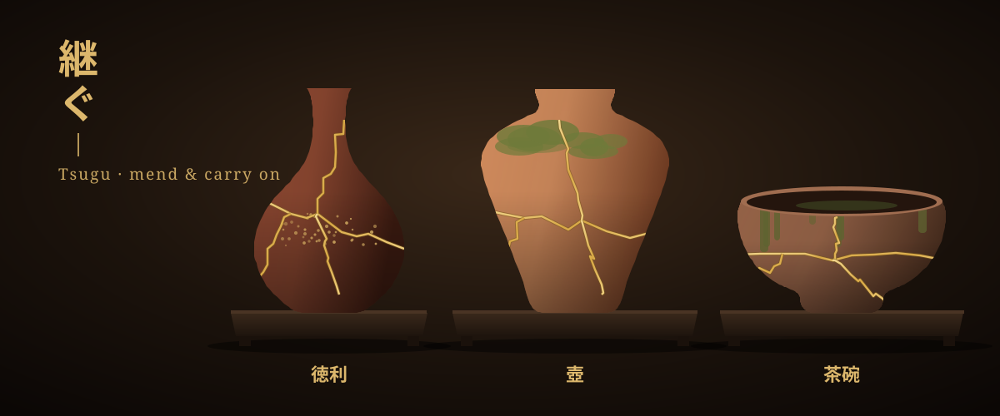

<p align="center">
  
</p>

# 継ぐ Tsugu · mend & carry on

**[Play it → aravinda89.github.io/tsugu](https://aravinda89.github.io/tsugu/)**

[English](#english) · [日本語](#日本語)

## English

A short, quiet ritual in 3D, based on **kintsugi**, the Japanese art of mending broken pottery with gold. Choose a pot, lift it and let it fall. Gather the pieces, trace gold along the cracks, and keep what you mended.

Every break is different, so every mended pot is one of a kind, with its own poetic name (銘 *mei*).

- **Three pots from Japan's old kilns:** a Bizen sake flask (徳利), a Shigaraki storage jar (壺) and a Tamba tea bowl (茶碗)
- **Real breaks:** each pot shatters its own way, with physics
- **Trace the gold yourself,** or let ✦ gild the rest
- **Koto music and a wind-bell,** made live in the browser
- **English and Japanese,** on phone and desktop

No timers, no score, no way to fail. About two minutes.

## 日本語

**金継ぎ**をもとにした、静かな3Dの小さな儀式です。器を選び、持ち上げて、手を離す。かけらを集め、ひびに沿って金をなぞり、繕った器を手元に残します。

割れ方は毎回ちがうので、繕った器はどれも世界に一つ。それぞれに銘がつきます。

- **古窯の器が三つ:** 備前の徳利、信楽の壺、丹波の茶碗
- **本当に割れる:** 物理演算で、毎回ちがう割れ方
- **金は自分でなぞる:** ✦ で残りを金に
- **箏と風鈴の音:** ブラウザの中で、その場で生まれる音
- **日本語と英語:** スマホでもパソコンでも

時間制限も点数もなく、失敗もありません。二分ほどの体験です。

## Run it locally · ローカルで動かす

```bash
npm install
npm run dev     # http://localhost:5173/tsugu/
npm test
```

Built with [Three.js](https://threejs.org/), [Rapier](https://rapier.rs/) physics and the Web Audio API. The pots, breaks, gold and sound are all generated in code: no 3D models, no audio files.

Three.js、Rapier(物理演算)、Web Audio API で作っています。器も割れも金も音も、すべてコードで生成しています。

## License

[MIT](LICENSE)
